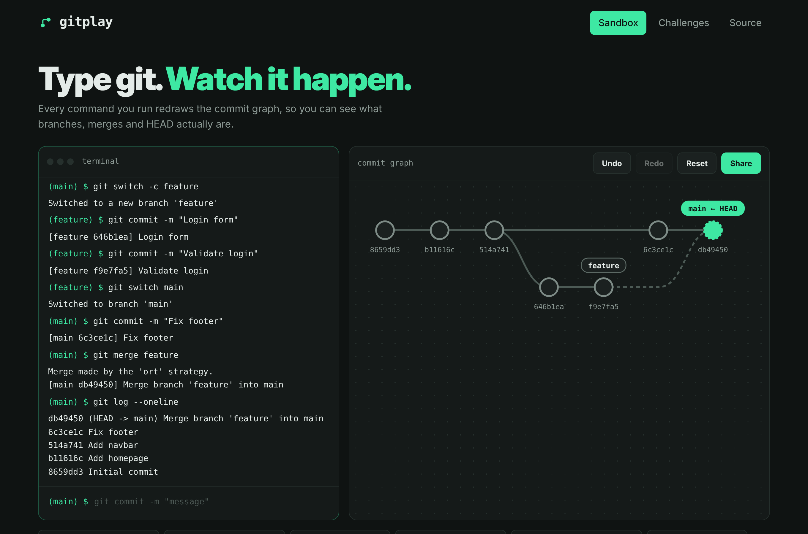
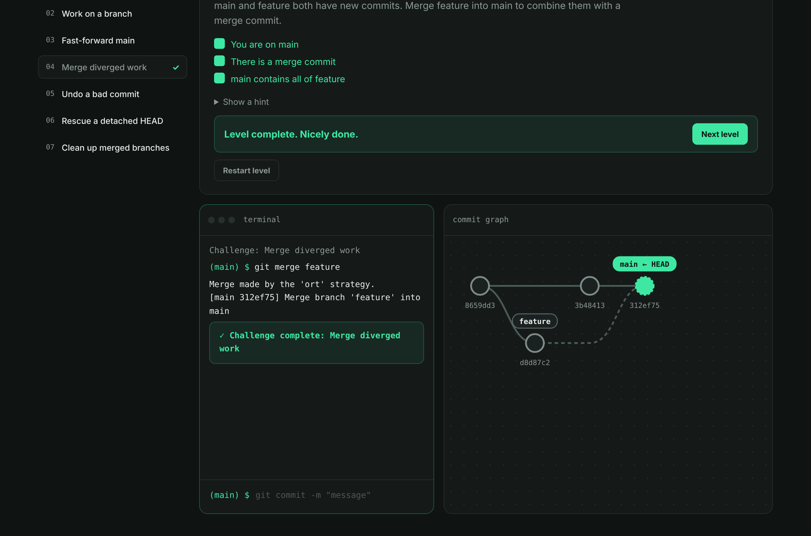
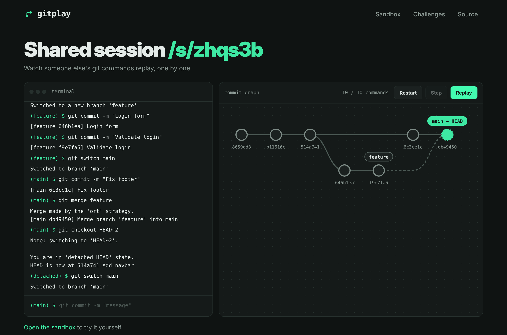

# gitplay

**Learn Git by playing.** Type real Git commands in a browser terminal and watch the commit graph animate as branches, merges and HEAD move.

Built by **Ejike Pius** ([@ejike_pius](https://x.com/ejike_pius)) with **vanilla JavaScript** on the front end and **PHP 8 + SQLite** on the back end. No frameworks, no dependencies.



## Features

- **Sandbox:** `commit`, `branch`, `checkout`, `switch`, `merge` (fast-forward and real merges), `reset --hard`, `log`, `status`
- **Animated SVG commit graph:** new commits pop in, branch labels slide when they move, and detached HEAD is highlighted
- **Undo / redo** for every command (buttons, or type `undo` / `redo`)
- **7 challenges** that check your graph against a goal, with a live checklist
- **Share a session:** saves your commands to the server and gives you a short link (`/s/k3x9p2`) that replays them step by step
- Refs like `HEAD~2`, `main^` and short commit ids, plus real Git error messages
- Your sandbox is saved in the browser, so a refresh doesn't lose your work

| Challenges | Shared session replay |
|---|---|
|  |  |

## How it works

```
Browser (JavaScript)                                Server (PHP)
┌───────────────────────────────────────┐     ┌──────────────────────────────┐
│ Terminal ──► commands.js ──► Repo.js  │     │ public/index.php (router)    │
│                 (parse)     (Git model)│     │                              │
│                                ▼       │     │ GET  /api/challenges ──► Challenges.php
│ Graph.js ◄──────────────── state       │     │ POST /api/sessions   ──► SessionValidator
│ (animated SVG)                         │     │                          ──► SessionRepository ──► SQLite
│                                        │     │ GET  /api/sessions/{id}  ──► SessionRepository
│ api.js ── fetch() + JSON ──────────────┼────►│                              │
└───────────────────────────────────────┘     └──────────────────────────────┘
```

**All the Git logic runs in the browser.** The server never runs Git. It serves the pages, the challenge definitions, and stores shared sessions.

### JavaScript (`public/assets/js/`)

| File | What it does |
|---|---|
| `engine/Repo.js` | The Git model. Commits form a DAG (each commit points to its parents), branches are names that point to commits, and HEAD points to a branch or straight to a commit (detached). Handles `resolve('HEAD~2')`, ancestry checks, fast-forward vs. merge commit. |
| `engine/parser.js` | Turns `git commit -m "fix bug"` into tokens, respecting quotes. |
| `engine/commands.js` | Maps each Git command to the model and returns Git-style output. |
| `engine/History.js` | Undo/redo using snapshots (the memento pattern). |
| `engine/goals.js` | Checks a repo against a challenge goal sent by PHP as JSON. |
| `ui/Graph.js` | Draws the graph as SVG. Nodes are *keyed* by commit id, so existing ones move (CSS transitions) instead of being redrawn. |
| `ui/Terminal.js` | Input line, output log, ↑/↓ command history, typing animation for replays. |
| `ui/Workspace.js` | Connects a Repo, its History, a Terminal and a Graph. Every page uses one. |
| `api.js` | The only file that calls the server. Adds the CSRF token and turns errors into exceptions. |
| `pages/*.js` | One small script per page: sandbox, challenges, replay. |

### PHP (`src/`, `public/index.php`, `views/`)

| File | What it does |
|---|---|
| `public/index.php` | Front controller. Routes pages and API endpoints. |
| `src/http.php` | `json_response()`, JSON body parsing with a size limit, CSRF token checks. |
| `src/SessionValidator.php` | Re-validates everything the browser sends (only `git ...` commands, length limits, no control characters). |
| `src/SessionRepository.php` | Saves and loads sessions in SQLite with prepared statements. Generates short, unambiguous ids. |
| `src/Challenges.php` | Challenge definitions. Add a level here and the front end picks it up automatically. |
| `views/` | PHP templates. The layout prints the CSRF token into `<meta name="csrf-token">`. |

### API

| Method | Path | Body | Response |
|---|---|---|---|
| `GET` | `/api/challenges` | none | `[{ id, title, intro, hint, setup, goal, checklist }]` |
| `POST` | `/api/sessions` | `{ "commands": ["git commit -m \"hi\""] }` + `X-CSRF-Token` header | `201 { id, url }` |
| `GET` | `/api/sessions/{id}` | none | `{ id, commands, created_at }` or `404` |

Errors always come back as `{ "error": "message" }` with a matching status code (`400`, `404`, `413`, `419`, `422`, `429`).

## Tests

```bash
npm test             # 26 JavaScript tests (Node's built-in runner, no install needed)
npm run test:php     # 8 PHP tests
```

The JavaScript tests cover the Git engine, parser and undo/redo. They also load the real challenge list **from PHP** and prove every challenge starts unsolved and can be solved, so the back end and front end can't drift apart.

## Run it locally

Requires PHP 8.1+ (with `pdo_sqlite`) and, for tests, Node 18+.

```bash
git clone https://github.com/pius-developer/gitplay.git
cd gitplay
php -S localhost:8000 -t public public/index.php
```

Open http://localhost:8000.

## License

MIT. Built by Ejike Pius.
